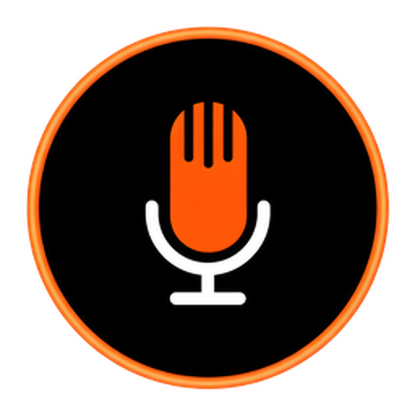
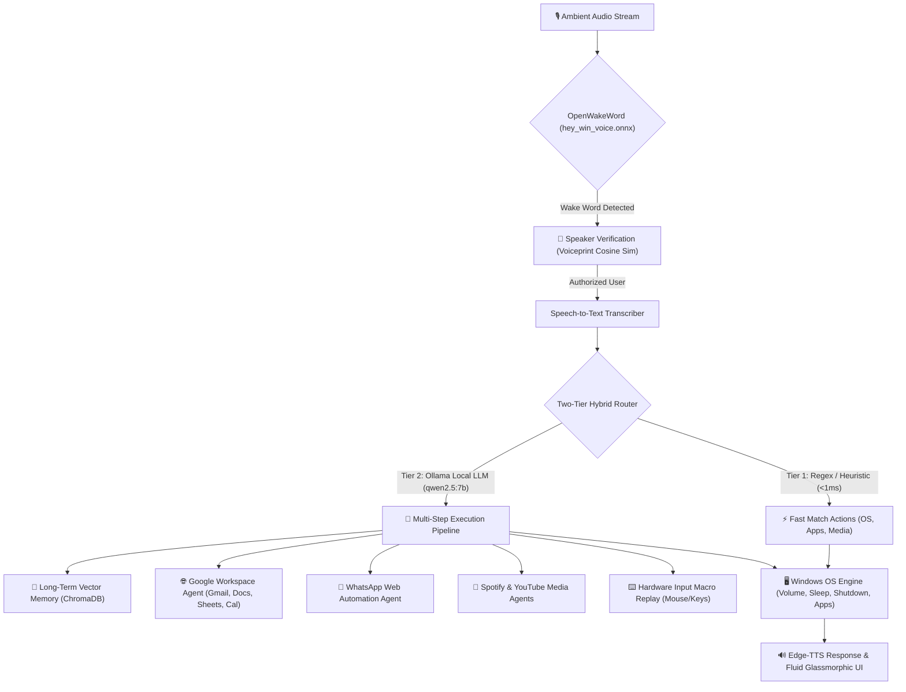

<div align="center">

  

  # WinVoice

  **Next-Generation, Privacy-First AI Desktop Operating Assistant for Windows**

  [-orange?style=for-the-badge)](https://github.com/Vem-Manish/WinVoice-App)
  [](https://python.org)
  [](https://fastapi.tiangolo.com)
  [](https://ollama.ai)
  [](https://microsoft.com)

  <p align="center">
    WinVoice transforms Windows into a fluid, voice-operated operating system. By combining an ultra-low-latency hybrid router, custom on-device wake-word detection, biometric speaker verification, and deep operating system hooks, WinVoice executes complex, multi-agent desktop workflows without mouse or keyboard interaction.
  </p>

</div>

---

> [!IMPORTANT]
> **Project Status: Active Work in Progress (WIP)**  
> WinVoice is under active, rapid development. Core features (hybrid router, wake word, speaker biometrics, Google Workspace, WhatsApp, vector memory, macros, and OS controls) are functional, while on-screen visual grounding and fully local quantized speech recognition are currently being refined.

---

## 🎥 Demo Video

<!-- Demo video embed / preview -->
<div align="center">
  <a href="https://github.com/Vem-Manish/WinVoice-App">
    
  </a>
  <br/><br/>
  <p><i>Click above or drop your recorded demo video (<code>demo.mp4</code> or GIF) into <code>assets/</code> to display live playback here.</i></p>
</div>

---

## ⚡ Key Highlights & Architecture

WinVoice differs fundamentally from simple wrappers around chat APIs: it is built as an **operating assistant** that lives alongside the user with continuous ambient awareness, hardware-level input automation, and zero-latency intent dispatching.



---

## 🚀 Current Progress & Implemented Features

### 1. Unified App Shell & Glassmorphic UI
* **Precision Dashboard:** Designed with Space Grotesk and JetBrains Mono typography, custom glassmorphism, and responsive micro-interactions.
* **Apple-Grade Drawer Physics:** Modals and menus expand organically from clicked sidebar trigger coordinates and collapse cleanly with zero visual jitter.
* **Acoustic Feedback Orb:** Real-time microphone listening orb with subtle hairline acoustic pulse rings for ambient feedback.
* **Connections Hub:** Centralized management of live OAuth 2.0 sessions (Google Workspace, Spotify) and WhatsApp Web sessions with live status telemetry.

### 2. Two-Tier Zero-Latency Hybrid Router
* **Tier 1 (Fast Matcher):** Regex and heuristic pattern matcher resolves ~70% of routine actions (app launching, URLs, YouTube queries, screen/volume adjustment, power states) in **$<1\,\text{ms}$**.
* **Tier 2 (Local LLM Smart Router):** Complex, multi-intent compound prompts fall back to a local Ollama model (`qwen2.5:7b`), resolving ambiguous pronouns, piping context across steps, and generating sequential execution schemas.
* **Server-Sent Events (SSE) Streaming:** Command execution telemetry and incremental agent logs stream back to the UI in real time via `/agent/execute`.

### 3. Ambient Wake-Word & Biometric Voice Authentication
* **Custom On-Device Wake Word:** Background audio listener running a custom `OpenWakeWord` ONNX model (`hey_win_voice.onnx`) with dynamic ambient noise floor calibration.
* **Biometric Speaker Verification:** Privileged operations (email dispatch, contact lookups, system power states) verify voice embeddings against enrolled voiceprints using cosine similarity thresholds, rejecting unauthorized speakers.

### 4. Long-Term Semantic Vector Memory
* **Persistent Embeddings:** Automatically captures facts, user preferences, and recurring context into an on-device ChromaDB vector database.
* **Contextual Recall:** Semantically retrieves relevant memories during command interpretation to resolve subjective queries (e.g., *"Email my project lead"* or *"Play my evening playlist"*).
* **Memory Logbook:** Interactive drawer panel to inspect, search, and manage learned associations.

### 5. Deep Operating System & Hardware Automation
* **Native Power States:** Hands-free voice execution of `shutdown /s /t 3`, `shutdown /r /t 3`, and suspend/sleep (`ctypes.windll.powrprof.SetSuspendState`) with graceful TTS audio pacing buffers.
* **Hardware Controls:** Win32 API and PowerShell bindings for display brightness, master audio volume, and graceful process termination.

### 6. Modular Agent Suite
| Agent | Capabilities |
| :--- | :--- |
| **Gmail** | Draft, search, read, and send emails; deep workspace links to exact email threads (`?authuser=...#all/<thread_id>`). |
| **Google Calendar** | Schedule events, query upcoming agendas, detect calendar conflicts. |
| **Google Docs & Sheets** | Create documents, write summaries, append rows, and query spreadsheets. |
| **Google Tasks & Contacts** | Day-bound to-do management and address book lookups. |
| **WhatsApp Web** | Automated contact lookup, hands-free text dictation, and document/image file attachments via browser automation. |
| **Spotify & YouTube** | Natural language track searches, playlist playback, volume, and playback controls. |
| **Input Macros** | Hardware-level keyboard and mouse recording (`INPUT_REPLAY`) with coordinate-exact replay for legacy Windows software. |
| **System Info** | Real-time CPU, RAM, battery percentage, charging state, and network metrics via `psutil`. |

---

## 🛠️ Tech Stack

* **Backend:** FastAPI, Uvicorn, Python 3.10+
* **Frontend Shell:** HTML5 / CSS3 (Glassmorphism), Jinja2, PySide6 / Electron
* **AI & Language Models:** Ollama (`qwen2.5:7b`), Google Gemini fallback
* **Audio & Speech:** OpenWakeWord (ONNX Runtime), Edge-TTS, Pygame, SpeechRecognition
* **Voice Biometrics:** SpeechBrain ECAPA-TDNN (PyTorch)
* **Vector Store:** ChromaDB
* **OS & Automation:** Win32 APIs, PyAutoGUI, Pyperclip, Pycaw, PowerShell

---

## 📦 Installation & Getting Started

### 1. Prerequisites
* **Windows 10 / 11 (64-bit)**
* **Python 3.10 or 3.11** installed and added to PATH
* **[Ollama](https://ollama.ai)** installed and running locally with the Qwen model:
  ```powershell
  ollama pull qwen2.5:7b
  ```

### 2. Clone the Repository
```powershell
git clone https://github.com/Vem-Manish/WinVoice-App.git
cd WinVoice-App
```

### 3. Create a Virtual Environment & Install Dependencies
```powershell
python -m venv .venv
.venv\Scripts\activate
pip install -r requirements.txt
```

### 4. Configure Environment Variables
Copy `.env.example` to `.env` and fill in your API credentials:
```powershell
cp .env.example .env
```
*(Fill in your Google OAuth Client ID/Secret, Spotify API keys, and optional Supabase URL).*

### 5. Launch WinVoice
You can launch either the FastAPI background server or the native desktop shell wrapper:

* **Desktop Shell (Recommended):**
  ```powershell
  python app_shell.py
  ```

* **Or Server Only:**
  ```powershell
  python main.py
  ```
  Open your browser and navigate to `http://127.0.0.1:8000`.

---

## 🔮 Upcoming Roadmap (Future Work)

* [ ] **Vision-Augmented Screen Grounding:** Integration of local vision models (OmniParser / Florence-2) for zero-API visual GUI navigation.
* [ ] **Sub-100ms Fully Local STT:** 4-bit quantized on-device Whisper via ONNX Runtime / Vulkan.
* [ ] **Multi-Speaker Meeting Diarization:** Continuous speaker attribution and meeting summary generation in noisy office environments.
* [ ] **Cross-Platform Abstraction:** Native driver abstraction layer for macOS and Linux environments.
* [ ] **Encrypted State Sync:** Zero-knowledge peer-to-peer synchronization of memories, voiceprints, and macros across multiple workstations.

---

## 📄 License & Attribution

Distributed under the MIT License. Developed by **[Manish Reddy](https://github.com/Vem-Manish)**.
Feel free to open an issue or pull request if you'd like to contribute!